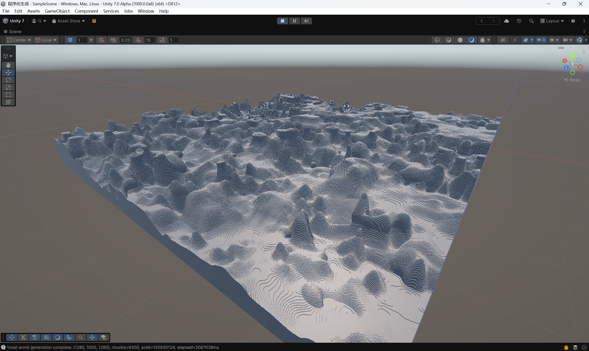
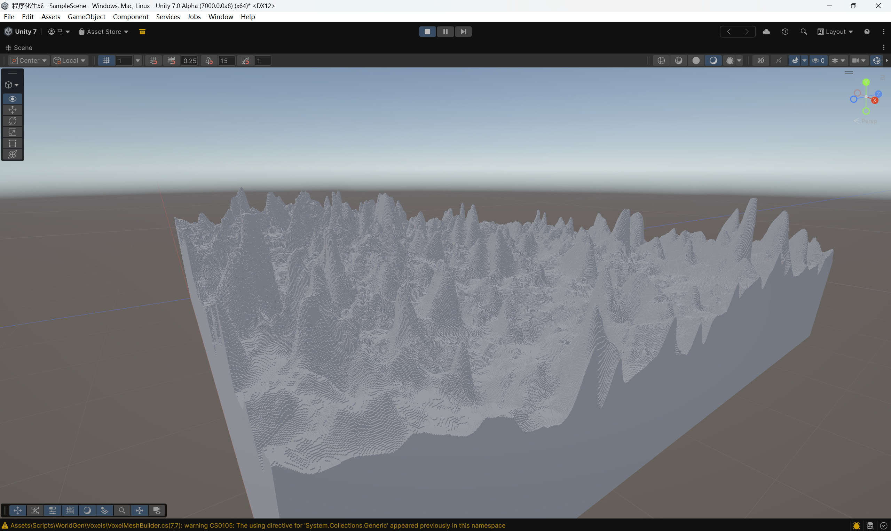

---
title: 2.2密度函数扩展-y轴渐变
description: 之前的密度函数过于简化，进一步扩展
---
## 源码方案
DensityFunctions.yClampedGradient(
    -64, 320,
    1.5, -1.5
)
规定最高与最低做渐变

1.得到渐变函数
YBase = YGradient(Y)

2.Offset =Spline(Continents, Erosion, Ridges)样条函数做偏移
HalfNegative=d > 0 ? d : d * 0.5
TerrainBase =YBase + Offset + Jaggedness × HalfNegative(JaggedNoise)

3.让不同位置的xz有不同程度的缩放
ScaledTerrain =Factor × TerrainBase

4. QuarterNegative=d > 0 ? d : d * 0.25
   >0放大<0缩小
SlopedCheese =4 × QuarterNegative(ScaledTerrain)
5.叠加进3d噪声中
FinalDensity = SlopedCheese + Base3DNoise
----
这里面对于得到y轴函数的处理，每个函数都是（x,z）相关
continents(x,z)  → 大陆性
erosion(x,z)     → 侵蚀度
ridges(x,z)      → 山脊度
offset(x,z)      → 整根柱子向上或向下移动
factor(x,z)      → 改变垂直变化幅度
jaggedness(x,z)  → 控制山顶起伏强度

因此xz不同的位置，y轴渐变不一样
先根据 XZ 确定“这根柱子是什么地形”
再根据 Y 计算“这根柱子在不同高度的密度”

感觉还行
再对基础3D噪声进行拓展，目前准备分型并且做多噪声的混合

