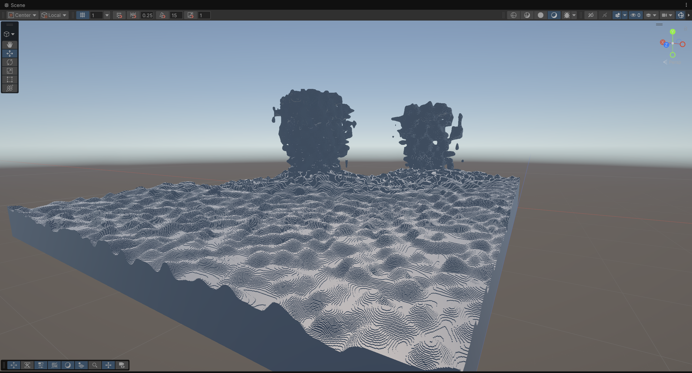
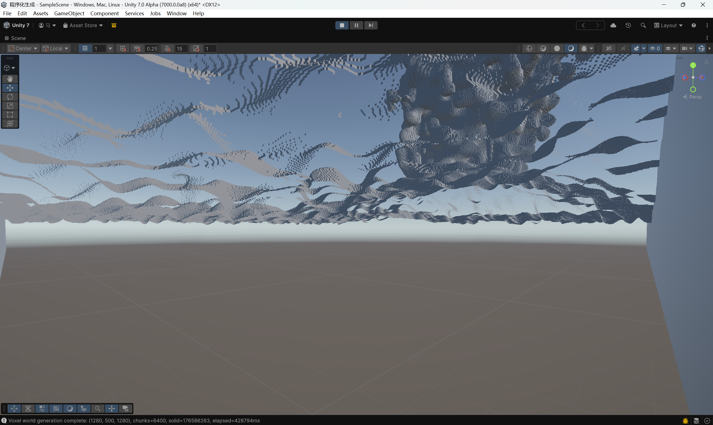
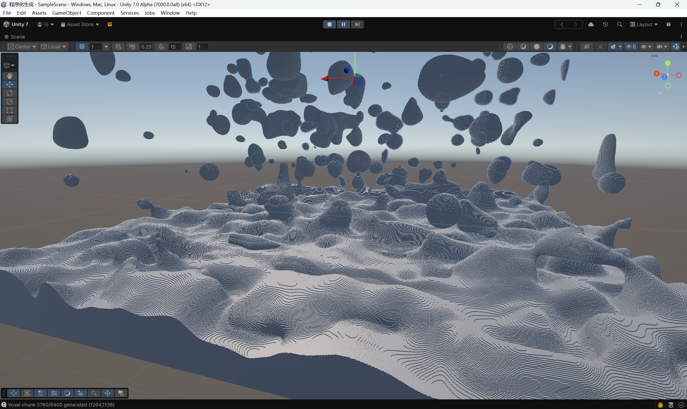
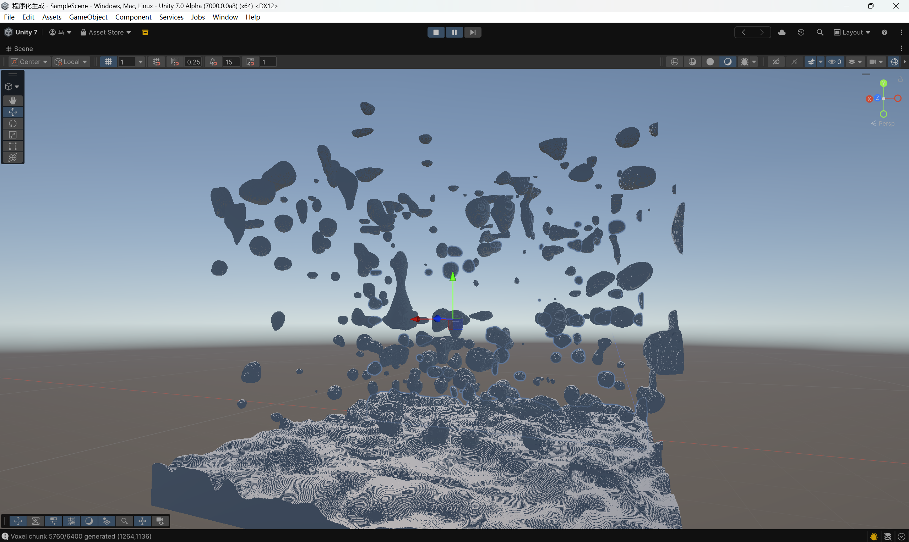

---
title: 2.1密度函数扩展-样条函数
description: 之前的密度函数过于简化，进一步扩展
---

## 密度函数
之前的密度函数十分简化：密度 = 山地项 + 细节噪声 + 垂直渐变 × 35

这是目前的密度函数产生的形状，可以看到十分奇怪，并且

地下是没有矿洞的
所以我们要调整密度函数，让生成的世界更完美
## 样条函数
说白了就是规定几个函数必须过的点，然后其他位置根据这些点来确定位置
### 1.最简单的分段样条函数
>double linear = Lerp(y0, y1, t);  
>(0, 0)  
>(10, 100)  
>(20, 30)  
>x = 5  -> 在第一段插值  
>x = 15 -> 在第二段插值  
### 2.Mc使用的是带斜率的三次样条
(location, value, derivative)
对于：  
左端斜率 = d0  
右端斜率 = d1
所以需要满足以下条件:
**注意样条函数不直接使用x，而是使用归一化坐标t**
>f(0) = y0
>f(1) = y1
>f'(0) = d0 × length(dy/dx=d0，所以对于dy/dt=dy/dx*lenght)
>(length=x1-x0;  )
>f'(1) = d1 × length 
*求解*
由于已经知道是三次函数
f(t) = a t³ + b t² + c t + d
根据上述条件解出
f(t) =
[m0 + m1 - 2Δ]t³+ [3Δ - 2m0 - m1]t²+ m0 t+ y0
其中
Δ = y1 - y0
m0 = d0 × length
m1 = d1 × length
---
化成更清楚的形式：
f(t) =Lerp(y0, y1, t)+t(1-t)Lerp(p, q, t)
其中
p = m0 - Δ
q = Δ - m1
*样条函数的作用是什么？*
如果offset = continents * 0.5;
那么两个数值变化趋势一致，很难表达复杂地形，
但是又要保持关联，所以
加入三个控制点：
>new[] { -1.0, 0.0, 1.0 }
>new[] { -0.8, 0.0, 0.8 }
>new[] {  0.0, 1.2, 0.0 }
大陆性       offset
-1.0         -0.8
-0.5         -0.5
 0.0          -0.1
 0.3           0.4
 0.7           1.2
 1.0           0.8
 ### 3.MC的样条函数嵌套
eg：
>主样条：以 continents 为输入
>   ├── continents = -0.5 -> 常量
>   ├── continents =  0.0 -> erosion 样条
>   └── continents =  0.5 -> ridges 样条
### 4.源码中的调用关系
continents
erosion
ridges
    ↓
TerrainProvider.overworldOffset(...)
TerrainProvider.overworldFactor(...)
TerrainProvider.overworldJaggedness(...)
    ↓
offset
factor
jaggedness
    ↓
...
从continents / erosion / ridges
    -> offset / factor / jaggedness
这是样条函数的作用
## 实装样条函数
*这个已经用上了3D噪声*

现在有点摸样了，但是可以看到上空非常乱

之后会给y轴的渐变再次优化
