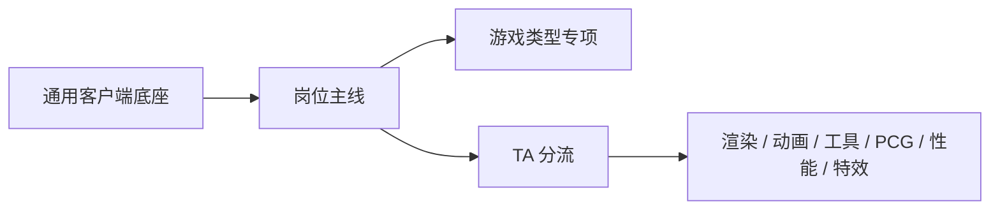

# Unity 客户端学习路线

这套路线面向希望进入游戏客户端研发、Gameplay、3C、客户端框架、性能、网络、渲染或技术美术岗位的人。它把学习内容分为三层：



## 先确定学习口径

“会一点所有客户端内容”适合作为建立地图的阶段，不适合作为长期投入方式。客户端岗位共享一部分底座，但日常工作和作品集已经明显分流。应采用下面的比例：

| 层级 | 建议投入 | 目标 |
| --- | ---: | --- |
| 通用底座 | 50% | C#、C++、数据结构、Unity 运行时、工程协作、调试与性能测量 |
| 主岗位方向 | 35% | Gameplay/3C、框架、性能、网络、渲染、工具或 TA 中选一条形成可识别能力 |
| 游戏类型专项 | 15% | FPS/TPS、ARPG、RTS、SLG、卡牌等选一个做项目语境 |

你当前最适合的主线是：

```text
Unity Gameplay → 3C / 战斗 → 性能与工程 → FPS/TPS 或 ARPG
```

TA 可以作为第二主线或横向协作能力。若最终希望转 TA，应尽早选择一个 TA 子方向制作作品集，而不是把所有 TA 都浅尝一遍。

## 九个通用模块

1. **语言与运行时**：C# 的值类型、引用、GC、委托、异步与线程，C++ 的对象模型、RAII、移动语义、模板、内存和并发。
2. **Unity 运行时**：生命周期、PlayerLoop、序列化、Prefab、场景、资源加载、Addressables、异步、输入、动画、物理和编辑器扩展。
3. **Gameplay 架构**：输入、角色、状态、技能、战斗、交互、UI、配置、事件、存档、回放和调试工具的边界设计。
4. **游戏算法与数学**：向量和坐标变换、几何判定、空间查询、寻路、感知、调度、状态机、行为树、批处理和分帧。
5. **性能与内存**：CPU/GPU/渲染线程、GC、对象池、资源内存、DrawCall、批处理、Profiler、Memory Profiler、Frame Debugger、RenderDoc。
6. **网络客户端**：协议、状态同步、预测、插值、回滚、客户端权威边界、断线重连、版本兼容与网络调试。
7. **工程交付**：Git、代码审查、测试、日志、配置、热更新、构建、CI、崩溃分析、跨平台和版本发布。
8. **内容生产协作**：编辑器工具、导入导出、资源规范、检查器、自动化管线、DCC 与引擎之间的数据流。
9. **项目与复盘**：固定范围、固定指标、可重复验证、问题记录、技术文档和作品展示。

## 学习阶段

| 阶段 | 重点 | 验收产出 |
| --- | --- | --- |
| 1. 底座补齐 | C# / C++ 运行机制、算法基础、Unity 生命周期 | 能解释一次对象从创建到销毁的完整路径 |
| 2. Gameplay 闭环 | 输入、移动、相机、动画、战斗、交互、UI | 一个可重开的小型战斗沙盒 |
| 3. 工程化 | 配置、资源、事件、状态、工具、测试和日志 | 能让非程序通过配置和工具扩展内容 |
| 4. 性能化 | Profiler、内存、渲染、批处理、Job/Burst | 一份有设备、输入、指标和前后对比的优化报告 |
| 5. 岗位分流 | 选择 Gameplay/3C、框架、性能、网络、渲染、工具或 TA | 一个能对应目标岗位的专项 Demo 和技术说明 |
| 6. 类型专项 | 选择 FPS/TPS、ARPG 或其他一个类型 | 能说明玩法约束如何影响客户端架构 |

## 相关页面

- [近两年岗位样本与能力地图](./00-岗位调研/01-近两年岗位样本与能力地图/)
- [通用底座](./01-通用底座/目录/)
- [客户端岗位主线](./02-岗位主线/目录/)
- [游戏类型专项](./03-游戏类型专项/目录/)
- [项目实践与验收](./04-项目实践与验收/目录/)
- [TA 方向](./05-TA方向/目录/)
- [游戏算法专栏](../游戏算法专栏/目录/)
- [游戏框架设计专栏](../游戏框架设计专栏/目录/)
- [Unity Job 与 Burst](../Unity-Job与Burst/目录/)
